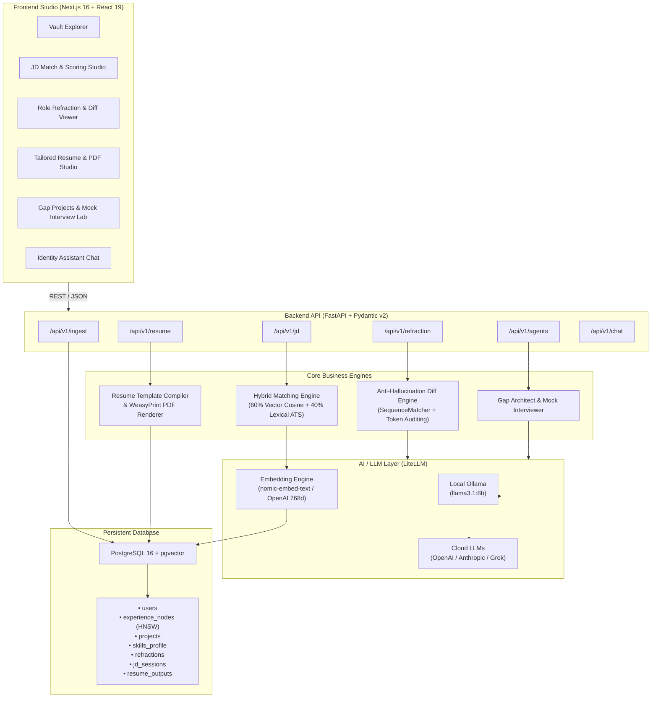

# LoomResume: The Cross-Functional Impact Engine

<div align="center">


**An AI-powered career identity platform that transforms your raw engineering achievements into verified, high-impact narratives tailored for target job roles with anti-hallucination guardrails.**

[Key Features](#-key-features) • [Architecture](#-architecture) • [Tech Stack](#-tech-stack) • [Quick Start](#-quick-start) • [API Reference](#-api-reference) • [Frontend Studio](#-frontend-studio) • [Testing](#-testing--quality)

</div>

---

## 💡 Why LoomResume?

Most AI resume builders treat resumes as static text, prompting LLMs to generate bullets from scratch. This leads to **hallucinated metrics, invented technologies, and generic summaries** that recruiters and ATS systems easily spot.

**LoomResume takes an engineer's database approach:**
1. **Source of Truth:** Treats your career history as a persistent, verified semantic database (Experience Vault).
2. **Anti-Hallucination Guardrails:** Reframes achievements across distinct engineering lenses (Platform, Infrastructure, Leadership, Business Impact, Data Engineering, Security) while enforcing strict factual token preservation and character bounds.
3. **Hybrid JD Matching:** Computes a 60/40 hybrid score (60% dense vector similarity + 40% lexical ATS keyword matching) to identify skill gaps accurately.
4. **Deterministic Resume Assembly:** Renders tailored, ATS-compliant HTML and vector-crisp PDF resumes.
5. **Actionable Career Agents:** Automatically architects production-grade gap-filler projects and scenario-based technical interview preparations for missing skills.

---

## 🏛 Architecture



---

## 🚀 Key Features

### 1. 🗄️ The Experience Vault
* Persistent career vault storing verified achievements, responsibilities, projects, and skills.
* Ingestion pipeline parses structured career data (`master_profile.json`), chunks experience bullets, and generates 768-dimensional dense vector embeddings with HNSW indexing in PostgreSQL `pgvector`.
* Immediate exploration through the `/api/v1/ingest/vault` endpoint and frontend Vault Explorer.

### 2. 🎯 Job Description (JD) Analysis & Hybrid Matching
* Extracts technical skills, seniority level, domain requirements, and key competencies from raw JD text.
* Generates a JD embedding and stores the search session.
* Evaluates candidate fit using a calibrated **Hybrid Match Score**:
  $$\text{Match Score} = 0.60 \times \text{CosineSimilarity}(\vec{E}_{\text{JD}}, \vec{E}_{\text{Experience}}) + 0.40 \times \text{LexicalOverlap}(\text{Keywords})$$
* Returns ranked experience nodes alongside granular **present keywords** vs. **missing keyword gaps**.

### 3. 🔮 Anti-Hallucination Role Refraction
Pivots raw technical achievements across **6 specialized lenses**:
| Lens | Core Focus | Example Narrative Pivot |
| :--- | :--- | :--- |
| **Platform** | Developer platforms, internal tooling, scalability, distributed systems | Emphasizes SDK design, internal API adoption, developer experience, and RPC throughput. |
| **Infrastructure** | Cloud primitives, IaC, Kubernetes, ECS, CI/CD, network reliability | Emphasizes cluster auto-scaling, Docker image optimization, zero-downtime rollouts, and multi-region failover. |
| **Leadership** | Cross-functional alignment, mentorship, technical roadmaps, engineering velocity | Emphasizes team unblocking, RFC leadership, sprint velocity improvements, and engineer mentorship. |
| **Business Impact** | Revenue attribution, cloud cost reduction, business KPIs, user retention | Emphasizes dollars saved on AWS spend, conversion rate lifts, and reduced incident downtime. |
| **Data Engineering** | ETL pipelines, stream processing, data modeling, event-driven architectures | Emphasizes Kafka/SQS queues, schema enforcement, throughput per second, and database partitioning. |
| **Security** | Zero-trust, compliance (SOC2/GDPR), threat mitigation, secrets management | Emphasizes IAM least privilege, mutual TLS, automated dependency scanning, and audit logging. |

#### 🛡️ Anti-Hallucination Guardrail Engine
- **Factual Token Preservation:** Extracts proper nouns, digits, percentages, tools, and technical terms from original text and verifies their presence in the reframed narrative.
- **Length Bounds:** Guardrails check character and word count ratios to prevent LLM bloat or truncation.
- **Diff Service:** Runs `difflib.SequenceMatcher` to generate word-level diffs, tracking additions, modifications, and deletions.
- **Self-Healing Loop:** Automatically retries up to 3 times with explicit correction prompts if factual tokens are omitted or ungrounded assertions are detected.

### 4. 📄 Tailored ATS Resume & Vector PDF Generation
* Compiles top-ranked experience nodes, refracted bullets, projects, and skills matching the target JD session.
* Renders semantic, clean HTML formatted according to modern ATS parsing standards.
* Generates downloadable vector PDFs using **WeasyPrint** (with pure-Python fallback support).
* Offers a direct `/api/v1/resume/render-pdf` endpoint to convert custom HTML into PDF on the fly.

### 5. 🧠 Career Agents
* **Gap-Filler Project Architect:** Examines missing skills identified in JD analysis and designs a production-grade project blueprint complete with architecture, tech stack, and step-by-step implementation phases.
* **Scenario Mock Interviewer:** Generates tough, scenario-based system design and technical interview questions based on the candidate's refracted background and the target JD.
* **Loom Identity Chat Assistant:** Context-aware chatbot grounded with the user's complete profile, achievements, and career identity.

---

## 🛠 Tech Stack

| Domain | Technology | Purpose |
| :--- | :--- | :--- |
| **Backend Framework** | **Python 3.13 / FastAPI** | High-performance asynchronous REST API |
| **LLM Orchestration** | **LiteLLM** | Provider-agnostic router (Ollama local, OpenAI, Anthropic, Grok) |
| **Embeddings** | **LangChain / nomic-embed-text** | 768-dimensional dense semantic vectors |
| **Vector Database** | **PostgreSQL 16 + pgvector** | HNSW cosine distance indexing and relational tables |
| **ORM & Migrations** | **SQLAlchemy 2.0 & Alembic** | Schema management and SQL migration scripts |
| **PDF Engine** | **WeasyPrint / pydyf** | Pixel-perfect ATS PDF compilation from HTML/CSS |
| **Frontend Framework** | **Next.js 16 (App Router)** | Modern React 19 UI with Server and Client components |
| **Styling & Icons** | **Tailwind CSS v4 & Lucide React** | Dark-mode developer studio design |
| **Testing & Quality** | **Pytest, Ruff, Black, Mypy** | Comprehensive test coverage, linting, formatting, and strict typing |

---

## 📁 Repository Structure

```text
LoomResume/
├── app/
│   ├── ai/                      # AI agents, prompt templates, and chains
│   │   ├── agents/              # Career agent definitions
│   │   ├── embeddings/          # Vector embedding generators
│   │   └── prompts/             # Refraction and persona prompt templates
│   ├── api/
│   │   └── v1/                  # REST API route controllers
│   │       ├── agents.py        # Gap-filler and mock interview endpoints
│   │       ├── chats.py         # Identity chat assistant
│   │       ├── health.py        # Health and database connectivity checks
│   │       ├── ingest.py        # Vault ingestion and profile inspector
│   │       ├── jd.py            # JD extraction and hybrid matching
│   │       ├── refraction.py    # Multi-lens refraction and diff auditing
│   │       └── resume.py        # Tailored resume compiler & PDF generation
│   ├── core/                    # App configuration, logging, and DB engine
│   ├── db/                      # SQLAlchemy models and schema definitions
│   ├── schemas/                 # Pydantic v2 validation models
│   ├── scripts/                 # CLI ingestion scripts
│   ├── services/                # Core business logic services
│   │   ├── agent_service.py     # Gap project & interview generation
│   │   ├── diff_service.py      # SequenceMatcher & fact token auditing
│   │   ├── embedding_service.py # Vector embedding coordinator
│   │   ├── jd_service.py        # JD parser & 60/40 hybrid scoring
│   │   ├── llm_service.py       # LiteLLM client wrapper
│   │   ├── refraction_service.py# Lens refraction & self-healing retry loop
│   │   ├── resume_service.py    # HTML assembly & WeasyPrint PDF renderer
│   │   └── retrieval_service.py # Vector similarity search
│   └── main.py                  # FastAPI application entry point
├── frontend/                    # Next.js 16 Frontend Studio
│   ├── src/
│   │   ├── app/                 # Next.js App Router (page.tsx, layout.tsx)
│   │   └── lib/                 # Typed API client library (api.ts)
│   ├── package.json             # Frontend dependencies
│   └── next.config.ts           # Next.js build configuration
├── migrations/                  # 10 Ordered SQL schema migrations
├── data/
│   └── master_profile.json      # Master career profile source of truth
├── tests/                       # Pytest test suite
│   ├── test_diff_service.py     # Factual token preservation & diff tests
│   ├── test_resume_service.py   # HTML/PDF compilation tests
│   └── test_retrieval_service.py# Vector matching & scoring tests
├── docker-compose.yml           # PostgreSQL + pgvector & App orchestration
├── Dockerfile                   # Production Python 3.13 container
├── pyproject.toml               # Poetry/pip build configuration & tool configs
└── .env.example                 # Environment configuration template
```

---

## ⚡ Quick Start

### Prerequisites
* **Python >= 3.13**
* **Node.js >= 20** and **npm**
* **Docker & Docker Compose** (for PostgreSQL + pgvector)
* *(Optional)* **Ollama** installed with `llama3.1:8b` and `nomic-embed-text` for 100% offline local inference.

---

### Option A: Local Development Setup

#### 1. Clone & Configure Environment
```bash
git clone https://github.com/sarathithikkatt/LoomResume.git
cd LoomResume

# Copy environment template
cp .env.example .env
```

#### 2. Start PostgreSQL with pgvector
You can run just the database using Docker Compose:
```bash
docker-compose up -d db
```

#### 3. Initialize Python Environment & Install Dependencies
```bash
# Create and activate virtual environment
python -m venv .venv

# Windows PowerShell:
.\.venv\Scripts\Activate.ps1
# Linux / macOS:
source .venv/bin/activate

# Install editable package with dev dependencies
pip install -e .[dev]
```

#### 4. Run Database Migrations
Apply the migrations using Alembic or execute the SQL scripts in `migrations/`:
```bash
alembic upgrade head
```

#### 5. Ingest Your Career Profile
Populate your Experience Vault with your profile data:
```bash
python -m app.scripts.ingest
```

#### 6. Start the Backend API Server
```bash
python -m uvicorn app.main:app --reload --host 0.0.0.0 --port 8000
```
* Interactive API Documentation: [http://localhost:8000/docs](http://localhost:8000/docs)
* Health Check: [http://localhost:8000/api/v1/health/](http://localhost:8000/api/v1/health/)

#### 7. Launch the Next.js Frontend Studio
In a new terminal window:
```bash
cd frontend
npm install
npm run dev
```
* Open your browser at [http://localhost:3000](http://localhost:3000).

---

### Option B: Full Docker Compose Setup

Run both the database and the FastAPI backend in isolated containers:
```bash
docker-compose up -d --build
```

---

## ⚙️ Configuration (.env)

| Variable | Default Value | Description |
| :--- | :--- | :--- |
| `POSTGRES_USER` | `postgres` | Database username |
| `POSTGRES_PASSWORD` | `password` | Database password |
| `POSTGRES_DB` | `loom_resume` | Database name |
| `POSTGRES_HOST` | `localhost` | Database host (`db` inside Docker network) |
| `POSTGRES_PORT` | `5432` | Database port |
| `DATABASE_URL` | `postgresql://...` | Full SQLAlchemy connection string |
| `LLM_DEFAULT_PROVIDER` | `ollama` | Default LLM provider (`ollama`, `openai`, `anthropic`, `grok`) |
| `LLM_DEFAULT_MODEL` | `ollama/llama3.1:8b`| LiteLLM model identifier (`gpt-4o`, `claude-3-5-sonnet-20241022`, etc.) |
| `OLLAMA_API_BASE` | `http://localhost:11434` | Ollama service base URL |
| `EMBEDDING_PROVIDER` | `auto` | Vector embedding engine (`auto`, `ollama`, or `openai`) |
| `OLLAMA_EMBEDDING_MODEL`| `nomic-embed-text` | Ollama embedding model name |
| `EMBEDDING_DIMENSIONS` | `768` | Embedding dimensionality (768 for nomic, 1536 for OpenAI) |
| `OPENAI_API_KEY` | *optional* | API Key for OpenAI models |
| `ANTHROPIC_API_KEY` | *optional* | API Key for Anthropic Claude models |
| `LOG_LEVEL` | `INFO` | Console log verbosity (`DEBUG`, `INFO`, `WARNING`, `ERROR`) |

---

## 📡 API Reference

### 1. Ingestion & Vault
| Method | Endpoint | Description |
| :--- | :--- | :--- |
| `POST` | `/api/v1/ingest/` | Trigger profile ingestion from `data/master_profile.json` |
| `GET` | `/api/v1/ingest/vault` | Retrieve the entire career vault (user, experience nodes, projects, skills) |
| `POST` | `/api/v1/ingest/nodes` | Create an experience node with auto-embedding vector generation |
| `PUT` | `/api/v1/ingest/nodes/{node_id}` | Update experience node and refresh vector embedding |
| `DELETE` | `/api/v1/ingest/nodes/{node_id}` | Remove an experience node from the vault |
| `POST` | `/api/v1/ingest/skills` | Add a new skill to the candidate profile |
| `DELETE` | `/api/v1/ingest/skills/{skill_id}` | Remove a skill from the profile |
| `POST` | `/api/v1/ingest/projects` | Add a project with auto-embedding vector generation |
| `PUT` | `/api/v1/ingest/projects/{project_id}` | Update project description and refresh embedding |
| `DELETE` | `/api/v1/ingest/projects/{project_id}` | Remove a project from the vault |
| `PUT` | `/api/v1/ingest/profile` | Update user summary and contact details |

### 2. Job Description (JD) Matching
| Method | Endpoint | Description |
| :--- | :--- | :--- |
| `POST` | `/api/v1/jd/analyze` | Parse JD keywords, domain, seniority, and compute embedding session |
| `GET` | `/api/v1/jd/{session_id}/score?user_id={id}` | Retrieve hybrid match score (vector + lexical overlap) and keyword breakdown |
| `GET` | `/api/v1/jd/{session_id}/matches?user_id={id}` | Retrieve ranked experience nodes matching the JD |

### 3. Role Refraction & Diff Auditing
| Method | Endpoint | Description |
| :--- | :--- | :--- |
| `POST` | `/api/v1/refraction/` | Refract a single experience node through a chosen lens with guardrails |
| `POST` | `/api/v1/refraction/jd/{session_id}` | Batch refract all matched nodes for a target JD |
| `GET` | `/api/v1/refraction/{refraction_id}/diff` | Get word-level diff, token retention report, and truncation audit |

### 4. Resume & PDF Generation
| Method | Endpoint | Description |
| :--- | :--- | :--- |
| `POST` | `/api/v1/resume/generate` | Compile tailored ATS resume HTML for a JD session, lens, and style template |
| `GET` | `/api/v1/resume/{resume_id}` | Fetch stored resume HTML content and metadata |
| `POST` | `/api/v1/resume/{resume_id}/template` | Re-render existing tailored resume under another style template |
| `GET` | `/api/v1/resume/{resume_id}/pdf` | Download rendered PDF version of the resume |
| `POST` | `/api/v1/resume/render-pdf` | Directly compile any raw HTML into PDF binary |

### 5. Career Agents & Chat
| Method | Endpoint | Description |
| :--- | :--- | :--- |
| `POST` | `/api/v1/agents/gap-project` | Architect a production gap-filler project addressing missing JD skills |
| `POST` | `/api/v1/agents/mock-interview` | Generate scenario-based technical interview questions & rubrics |
| `POST` | `/api/v1/chat/` | Conversational identity assistant query |

---

## 💻 Frontend Studio

The Next.js frontend at [http://localhost:3000](http://localhost:3000) provides an intuitive developer interface organized into 6 tabs:

1. **Vault Explorer:** Inspect your stored roles, achievement bullets, skill categories, and projects.
2. **JD Match & Scoring:** Paste any target Job Description to view instant keyword extraction, hybrid compatibility score gauge, and missing skill gaps.
3. **Refraction & Diff Studio:** Switch between the 6 lenses, view real-time factual token audits, and inspect side-by-side token diffs.
4. **Resume & PDF Studio:** Preview ATS-formatted HTML resumes with live CSS styling and download generated PDFs in one click.
5. **Gap Projects & Mock Interview:** Generate production project specifications to fill resume gaps and practice real-world interview scenarios.
6. **Identity Assistant:** Chat with your career vault to brainstorm cover letters, salary negotiations, or leadership stories.

---

## 🧪 Testing & Quality

LoomResume enforces strict automated testing, formatting, and linting.

```bash
# Run the complete Pytest suite
pytest

# Check code formatting with Black
black --check app tests

# Run linter checks with Ruff
ruff check app tests

# Run static type checking with Mypy
mypy app
```

---

## 🗺 Roadmap

- [x] **Phase 1: Core Vault & Ingestion:** RAG-based persistent storage with PostgreSQL pgvector embeddings.
- [x] **Phase 2: JD Contextualization & Hybrid Matcher:** 60/40 vector semantic + lexical ATS score.
- [x] **Phase 3: Anti-Hallucination Refraction:** 6-lens narrative reframing with fact preservation checks and diff auditing.
- [x] **Phase 4: Tailored Resume & PDF Generation:** Dynamic ATS HTML compilation and WeasyPrint PDF export.
- [x] **Phase 5: Career Agents:** Gap-filler project architect, mock interview generator, and identity chat assistant.
- [x] **Phase 6: Next.js 16 Web Studio:** Interactive dark-mode dashboard with comprehensive workflow tabs.
- [ ] **Phase 7: Automated Job Board Integrations:** Direct one-click import of JDs from LinkedIn, Greenhouse, and Lever.

---

## 📄 License

This project is licensed under the MIT License — see the LICENSE file for details.
