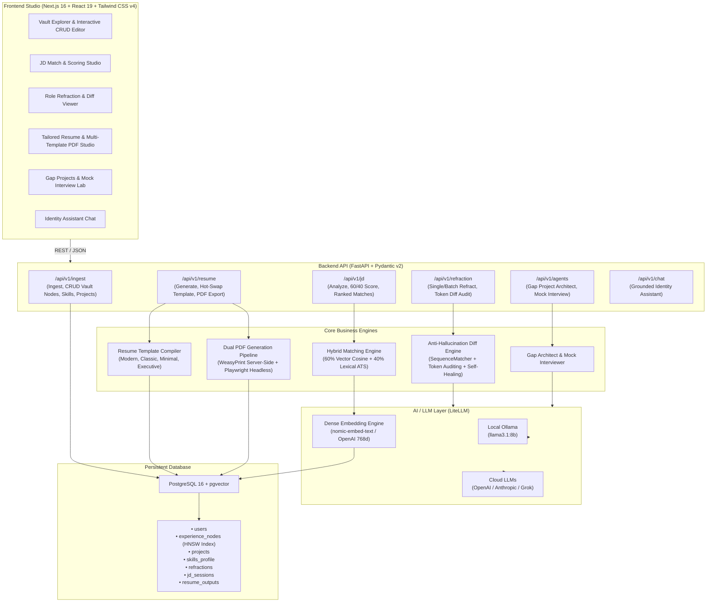
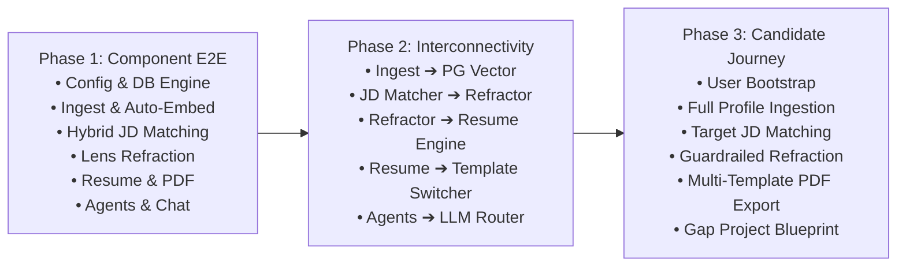

# LoomResume: The Cross-Functional Impact Engine

<div align="center">


**An AI-powered career identity platform that transforms your raw engineering achievements into verified, high-impact narratives tailored for target job roles with anti-hallucination guardrails, multi-template ATS resume rendering, and career gap-filler agents.**

[Key Features](#-key-features) • [Architecture](#-architecture) • [Multi-Template Resume Engine](#-multi-template-ats-resume-engine) • [Interactive Vault Studio](#-interactive-experience-vault-studio) • [3-Phase E2E Verification](#-3-phase-end-to-end-verification) • [Quick Start](#-quick-start) • [API Reference](#-api-reference) • [Frontend Studio](#-frontend-studio)

</div>

---

## 💡 Why LoomResume?

Most AI resume builders treat resumes as disposable text prompts, asking LLMs to invent bullet points from scratch. This introduces **hallucinated metrics, invented technologies, and generic summaries** that fail recruiter screens and automated ATS checks.

**LoomResume takes an engineer's database approach:**
1. **Persistent Source of Truth:** Treats your career history as a verified semantic database (Experience Vault) with 768-dimensional dense vector embeddings in PostgreSQL `pgvector`.
2. **Anti-Hallucination Guardrails:** Reframes achievements across 6 specialized engineering lenses (Platform, Infrastructure, Leadership, Business Impact, Data Engineering, Security) while enforcing strict factual token preservation, character bounds, and word-level sequence diff auditing.
3. **Calibrated Hybrid JD Matching:** Computes a 60/40 hybrid score (60% dense cosine vector similarity + 40% lexical ATS keyword matching) to identify exact competency overlaps and missing skill gaps.
4. **Multi-Template ATS Resume Engine:** Compiles and renders tailored resumes across 4 professionally engineered ATS design templates (**Modern**, **Classic**, **Minimal**, **Executive**) with real-time template switching and dual PDF export pipelines (WeasyPrint and headless Playwright Chromium).
5. **Interactive Vault Studio:** Full CRUD capabilities allowing engineers to create, update, and prune experience nodes, skills, and projects with automated live vector re-indexing.
6. **Actionable Career Agents:** Automatically architects production-grade gap-filler project blueprints and scenario-based technical interview questions for any identified skill gaps.

---

## 🏛 Architecture



---

## 🚀 Key Features

### 1. 🗄️ The Experience Vault & Live CRUD Editor
* **Persistent Career Vault:** Stores verified achievements, responsibilities, projects, and skills.
* **Vector Embeddings & HNSW:** Ingestion parses structured career data (`master_profile.json`), chunks experience bullets, and generates 768-dimensional dense vector embeddings with HNSW indexing in PostgreSQL `pgvector`.
* **Live Interactive Management:** Full programmatic and UI-based CRUD operations to add, update, or delete experience nodes, skills, and projects on the fly with automatic vector embedding re-generation.
* **Profile Metadata Updates:** Modify professional summaries, contact information, and target titles with instant database synchronization.

### 2. 🎯 Job Description (JD) Analysis & Hybrid Matching
* **Semantic & Keyword Extraction:** Extracts technical skills, seniority level, domain requirements, and key competencies from raw job descriptions.
* **60/40 Hybrid Scoring Algorithm:** Evaluates candidate fit using a calibrated formula:
  $$\text{Match Score} = 0.60 \times \text{CosineSimilarity}(\vec{E}_{\text{JD}}, \vec{E}_{\text{Experience}}) + 0.40 \times \text{LexicalOverlap}(\text{Keywords})$$
* **Ranked Experience Alignment:** Returns ranked experience nodes matching the JD alongside an itemized breakdown of **matched keywords** versus **missing keyword gaps**.

### 3. 🔮 Anti-Hallucination Role Refraction
Reframes raw technical achievements across **6 specialized engineering lenses** without hallucinating unearned qualifications:

| Lens | Core Focus | Example Narrative Pivot |
| :--- | :--- | :--- |
| **Platform** | Developer platforms, internal tooling, scalability, distributed systems | Emphasizes SDK design, internal API adoption, developer experience, and RPC throughput. |
| **Infrastructure** | Cloud primitives, IaC, Kubernetes, ECS, CI/CD, network reliability | Emphasizes cluster auto-scaling, Docker image optimization, zero-downtime rollouts, and multi-region failover. |
| **Leadership** | Cross-functional alignment, mentorship, technical roadmaps, engineering velocity | Emphasizes team unblocking, RFC leadership, sprint velocity improvements, and engineer mentorship. |
| **Business Impact** | Revenue attribution, cloud cost reduction, business KPIs, user retention | Emphasizes dollars saved on AWS spend, conversion rate lifts, and reduced incident downtime. |
| **Data Engineering** | ETL pipelines, stream processing, data modeling, event-driven architectures | Emphasizes Kafka/SQS queues, schema enforcement, throughput per second, and database partitioning. |
| **Security** | Zero-trust, compliance (SOC2/GDPR), threat mitigation, secrets management | Emphasizes IAM least privilege, mutual TLS, automated dependency scanning, and audit logging. |

#### 🛡️ Anti-Hallucination Guardrail Engine
- **Factual Token Preservation:** Extracts proper nouns, digits, percentages, tools, and technical terms from original text and verifies their presence in the reframed narrative.
- **Length Bounds:** Guardrails check character and word count ratios to prevent LLM bloat or truncation.
- **Diff Service:** Runs `difflib.SequenceMatcher` to generate word-level diffs, tracking additions, modifications, and deletions.
- **Self-Healing Loop:** Automatically retries up to 3 times with explicit correction prompts if factual tokens are omitted or ungrounded assertions are detected.

---

## 🎨 Multi-Template ATS Resume Engine

LoomResume features a decoupled resume compilation architecture that formats candidate data into 4 distinct ATS-compliant design templates:

| Template | Typography | Best Suited For | Key Aesthetic |
| :--- | :--- | :--- | :--- |
| **`modern`** | Sans-Serif (Helvetica / Arial) | Software Engineers, Tech Leads, Cloud Architects | Clean horizontal dividers, bold role titles, balanced margins (0.55in), high scannability. |
| **`classic`** | Serif (Georgia / Times) | Finance, Fintech, Enterprise, Traditional Engineering | Traditional academic typography, subtle dividers, refined hierarchy, elegant print balance. |
| **`minimal`** | Clean Sans-Serif + Monospace Meta | Senior ICs, Systems Programmers, Infrastructure Engineers | Tight margins (0.45in), monospaced contact/metadata line, maximum information density. |
| **`executive`** | Slate-Accent Sans-Serif | Staff/Principal Engineers, Engineering Directors | Subtle accent underlines, distinct section titling, prominent leadership metrics. |

### Dynamic Template Hot-Swapping
Switch templates without re-running LLM generation:
```http
POST /api/v1/resume/{resume_id}/template
Content-Type: application/json

{
  "template": "classic"
}
```
The resume engine re-renders the document using the target layout and returns updated HTML and compiled PDF payloads instantaneously.

### Dual PDF Generation Pipeline
1. **Server-Side Rendering (WeasyPrint):** Built-in headless HTML-to-PDF rendering directly inside FastAPI with pure-Python fallback.
2. **Precision Browser-Grade Rendering (Playwright):** Dedicated single-page PDF compiler (`build_resumes.py`) running headless Chromium with custom CSS print page bounds (`@page { size: letter; margin: 0.35in 0.45in; }`) for sub-millimeter layout guarantees and strict 1-page constraints.

---

## 🧪 3-Phase End-to-End Verification

LoomResume incorporates an automated 3-phase verification test suite (`tests/run_e2e_verification.py` and `tests/test_e2e_comprehensive.py`):



Run the complete verification suite anytime:
```bash
python tests/run_e2e_verification.py
```

---

## 🛠 Tech Stack

| Domain | Technology | Purpose |
| :--- | :--- | :--- |
| **Backend Framework** | **Python 3.13 / FastAPI** | High-performance asynchronous REST API |
| **LLM Orchestration** | **LiteLLM** | Provider-agnostic router (Ollama local, OpenAI, Anthropic, Grok) |
| **Embeddings** | **LangChain / nomic-embed-text** | 768-dimensional dense semantic vectors |
| **Vector Database** | **PostgreSQL 16 + pgvector** | HNSW cosine distance indexing and relational tables |
| **ORM & Migrations** | **SQLAlchemy 2.0 & Alembic** | Schema management and SQL migration scripts |
| **PDF Engines** | **WeasyPrint & Playwright (Chromium)** | Dual-engine pixel-perfect ATS PDF compilation |
| **Frontend Framework** | **Next.js 16 (App Router)** | Modern React 19 UI with Server and Client components |
| **Styling & Components** | **Tailwind CSS v4 & Lucide React** | Dark-mode developer studio design |
| **Testing & Quality** | **Pytest, Ruff, Black, Mypy** | 3-phase verification, strict typing, and linting |

---

## 📁 Repository Structure

```text
LoomResume/
├── app/
│   ├── ai/                      # AI agents, prompt templates, and chains
│   │   ├── agents/              # Career agent definitions (Gap project & interview)
│   │   ├── embeddings/          # Vector embedding generators
│   │   └── prompts/             # Refraction and persona prompt templates
│   ├── api/
│   │   └── v1/                  # REST API route controllers
│   │       ├── agents.py        # Gap-filler and mock interview endpoints
│   │       ├── chats.py         # Identity chat assistant
│   │       ├── health.py        # Health and database connectivity checks
│   │       ├── ingest.py        # Vault ingestion, profile updates, and CRUD endpoints
│   │       ├── jd.py            # JD extraction and 60/40 hybrid matching
│   │       ├── refraction.py    # Multi-lens refraction and diff auditing
│   │       └── resume.py        # Multi-template resume compiler & PDF generation
│   ├── core/                    # App configuration, logging, and DB engine
│   ├── db/                      # SQLAlchemy models and schema definitions
│   ├── schemas/                 # Pydantic v2 validation models
│   ├── scripts/                 # CLI ingestion scripts
│   ├── services/                # Core business logic services
│   │   ├── agent_service.py     # Gap project & interview generation
│   │   ├── diff_service.py      # SequenceMatcher & fact token auditing
│   │   ├── embedding_service.py # Vector embedding coordinator
│   │   ├── jd_service.py        # JD parser & 60/40 hybrid scoring
│   │   ├── llm_service.py       # LiteLLM client wrapper
│   │   ├── refraction_service.py# Lens refraction & self-healing retry loop
│   │   ├── resume_service.py    # HTML assembly (4 templates) & PDF renderer
│   │   └── retrieval_service.py # Vector similarity search
│   └── main.py                  # FastAPI application entry point
├── frontend/                    # Next.js 16 Frontend Studio
│   ├── src/
│   │   ├── app/                 # Next.js App Router (page.tsx, layout.tsx)
│   │   └── lib/                 # Typed API client library (api.ts)
│   ├── package.json             # Frontend dependencies
│   └── next.config.ts           # Next.js build configuration
├── migrations/                  # 10 Ordered SQL schema migrations
├── data/
│   └── master_profile.json      # Master career profile source of truth
├── tests/                       # Comprehensive test suite
│   ├── run_e2e_verification.py  # 3-Phase E2E test runner
│   ├── test_e2e_comprehensive.py# Comprehensive Pytest E2E suite
│   ├── test_vault_endpoints.py  # Vault CRUD API tests
│   ├── test_resume_service.py   # Multi-template HTML/PDF compilation tests
│   ├── test_diff_service.py     # Factual token preservation & diff tests
│   └── test_retrieval_service.py# Vector matching & scoring tests
├── build_resumes.py             # Playwright Chromium high-fidelity 1-page PDF builder
├── docker-compose.yml           # PostgreSQL + pgvector & App orchestration
├── Dockerfile                   # Production Python 3.13 container
├── pyproject.toml               # Build configuration, dependencies, & tool configs
└── .env.example                 # Environment configuration template
```

---

## ⚡ Quick Start

### Prerequisites
* **Python >= 3.13**
* **Node.js >= 20** and **npm**
* **Docker & Docker Compose** (for PostgreSQL + pgvector)
* *(Optional)* **Ollama** installed with `llama3.1:8b` and `nomic-embed-text` for 100% offline local inference.

---

### Option A: Local Development Setup

#### 1. Clone & Configure Environment
```bash
git clone https://github.com/sarathithikkatt/LoomResume.git
cd LoomResume

# Copy environment template
cp .env.example .env
```

#### 2. Start PostgreSQL with pgvector
```bash
docker-compose up -d db
```

#### 3. Initialize Python Environment & Install Dependencies
```bash
# Create and activate virtual environment
python -m venv .venv

# Windows PowerShell:
.\.venv\Scripts\Activate.ps1
# Linux / macOS:
source .venv/bin/activate

# Install editable package with dev dependencies
pip install -e .[dev]
```

#### 4. Run Database Migrations
Apply migrations using Alembic:
```bash
alembic upgrade head
```

#### 5. Ingest Your Career Profile
Populate your Experience Vault with your profile data:
```bash
python -m app.scripts.ingest
```

#### 6. Start the Backend API Server
```bash
python -m uvicorn app.main:app --reload --host 0.0.0.0 --port 8000
```
* Interactive API Documentation: [http://localhost:8000/docs](http://localhost:8000/docs)
* Health Check: [http://localhost:8000/api/v1/health/](http://localhost:8000/api/v1/health/)

#### 7. Launch the Next.js Frontend Studio
In a new terminal window:
```bash
cd frontend
npm install
npm run dev
```
* Open your browser at [http://localhost:3000](http://localhost:3000).

---

### Option B: Standalone Resume Generation with Playwright

To compile single-page, ATS-optimized vector resumes directly to HTML and PDF using the Playwright browser compiler:
```bash
# Ensure Playwright chromium is installed
playwright install chromium

# Run the build script
python build_resumes.py
```
This generates pixel-perfect targeted resumes (`Frontend`, `FullStack`, `Fintech`) with sub-millimeter print margin accuracy.

---

### Option C: Full Docker Compose Setup

Run both the database and the FastAPI backend in isolated containers:
```bash
docker-compose up -d --build
```

---

## 📡 API Reference

### 1. Ingestion & Experience Vault Management
| Method | Endpoint | Description |
| :--- | :--- | :--- |
| `POST` | `/api/v1/ingest/` | Trigger profile ingestion from `data/master_profile.json` |
| `GET` | `/api/v1/ingest/vault` | Retrieve the entire career vault (user, experience nodes, projects, skills) |
| `POST` | `/api/v1/ingest/nodes` | Create an experience node with automatic 768-d vector embedding |
| `PUT` | `/api/v1/ingest/nodes/{node_id}` | Update experience node text and refresh vector embedding |
| `DELETE` | `/api/v1/ingest/nodes/{node_id}` | Remove an experience node from the vault |
| `POST` | `/api/v1/ingest/skills` | Add a new skill to the candidate profile |
| `DELETE` | `/api/v1/ingest/skills/{skill_id}` | Remove a skill from the profile |
| `POST` | `/api/v1/ingest/projects` | Add a project with auto-embedding vector generation |
| `PUT` | `/api/v1/ingest/projects/{project_id}` | Update project description and refresh vector embedding |
| `DELETE` | `/api/v1/ingest/projects/{project_id}` | Remove a project from the vault |
| `PUT` | `/api/v1/ingest/profile` | Update user personal details, summary, and headline |

### 2. Job Description (JD) Matching
| Method | Endpoint | Description |
| :--- | :--- | :--- |
| `POST` | `/api/v1/jd/analyze` | Parse JD keywords, domain, seniority, and compute embedding session |
| `GET` | `/api/v1/jd/{session_id}/score?user_id={id}` | Retrieve 60/40 hybrid score (vector + lexical overlap) and keyword breakdown |
| `GET` | `/api/v1/jd/{session_id}/matches?user_id={id}` | Retrieve ranked experience nodes matching the JD |

### 3. Role Refraction & Diff Auditing
| Method | Endpoint | Description |
| :--- | :--- | :--- |
| `POST` | `/api/v1/refraction/` | Refract a single experience node through a chosen lens with guardrails |
| `POST` | `/api/v1/refraction/jd/{session_id}` | Batch refract all matched nodes for a target JD |
| `GET` | `/api/v1/refraction/{refraction_id}/diff` | Get word-level diff, token retention report, and truncation audit |

### 4. Resume & PDF Generation
| Method | Endpoint | Description |
| :--- | :--- | :--- |
| `POST` | `/api/v1/resume/generate` | Compile tailored ATS resume HTML for a JD session, lens, and template (`modern`, `classic`, `minimal`, `executive`) |
| `GET` | `/api/v1/resume/{resume_id}` | Fetch stored resume HTML content and template metadata |
| `POST` | `/api/v1/resume/{resume_id}/template` | Hot-swap and re-render existing resume under a different style template |
| `GET` | `/api/v1/resume/{resume_id}/pdf` | Download rendered PDF version of the resume |
| `POST` | `/api/v1/resume/render-pdf` | Directly compile any raw HTML into PDF binary |

### 5. Career Agents & Chat
| Method | Endpoint | Description |
| :--- | :--- | :--- |
| `POST` | `/api/v1/agents/gap-project` | Architect a production gap-filler project addressing missing JD skills |
| `POST` | `/api/v1/agents/mock-interview` | Generate scenario-based technical interview questions & rubrics |
| `POST` | `/api/v1/chat/` | Conversational identity assistant query grounded in candidate profile |

---

## 💻 Frontend Studio

The Next.js frontend at [http://localhost:3000](http://localhost:3000) provides an intuitive dark-mode developer interface organized into 6 tabs:

1. **Vault Explorer & Live Editor:** Inspect and edit stored roles, achievement bullets, skill categories, and projects with real-time vector re-indexing.
2. **JD Match & Scoring:** Paste target Job Descriptions to view instant keyword extraction, a 60/40 hybrid compatibility score gauge, and missing skill gap badges.
3. **Refraction & Diff Studio:** Switch between the 6 engineering lenses, inspect factual token audit badges, and view side-by-side sequence diffs.
4. **Resume & PDF Studio:** Select between **Modern**, **Classic**, **Minimal**, or **Executive** ATS templates, preview rendered HTML, and download pixel-perfect PDFs in one click.
5. **Gap Projects & Mock Interview:** Generate production project blueprints to bridge skill gaps and practice scenario-based interview questions.
6. **Identity Assistant:** Chat with your career vault to brainstorm tailored cover letters, behavioral examples, or salary negotiation narratives.

---

## 🧪 Testing & Quality Assurance

LoomResume enforces strict automated testing, code formatting, and type safety:

```bash
# Run the 3-Phase Comprehensive E2E Verification Suite
python tests/run_e2e_verification.py

# Run the complete Pytest test suite
pytest

# Check code formatting with Black
black --check app tests

# Run linter checks with Ruff
ruff check app tests

# Run static type checking with Mypy
mypy app
```

---

## 🗺 Roadmap

- [x] **Phase 1: Core Vault & Ingestion:** RAG-based persistent storage with PostgreSQL pgvector embeddings.
- [x] **Phase 2: JD Contextualization & Hybrid Matcher:** 60/40 vector semantic + lexical ATS score.
- [x] **Phase 3: Anti-Hallucination Refraction:** 6-lens narrative reframing with fact preservation checks and diff auditing.
- [x] **Phase 4: Multi-Template Resume Engine & Vector PDF:** Dynamic ATS HTML compilation across 4 styles (`modern`, `classic`, `minimal`, `executive`) and WeasyPrint / Playwright PDF export.
- [x] **Phase 5: Interactive Experience Vault Management:** Full CRUD operations and live vector re-indexing for nodes, projects, and skills.
- [x] **Phase 6: Career Agents:** Gap-filler project architect, mock interview generator, and identity chat assistant.
- [x] **Phase 7: Next.js 16 Web Studio:** Interactive dark-mode dashboard with comprehensive workflow tabs.
- [x] **Phase 8: 3-Phase E2E Verification Suite:** Automated Component, Interconnectivity, and Candidate Journey testing.
- [ ] **Phase 9: Automated Job Board Integrations:** Direct one-click import of JDs from LinkedIn, Greenhouse, and Lever.

---

## 📄 License

This project is licensed under the MIT License — see the LICENSE file for details.
